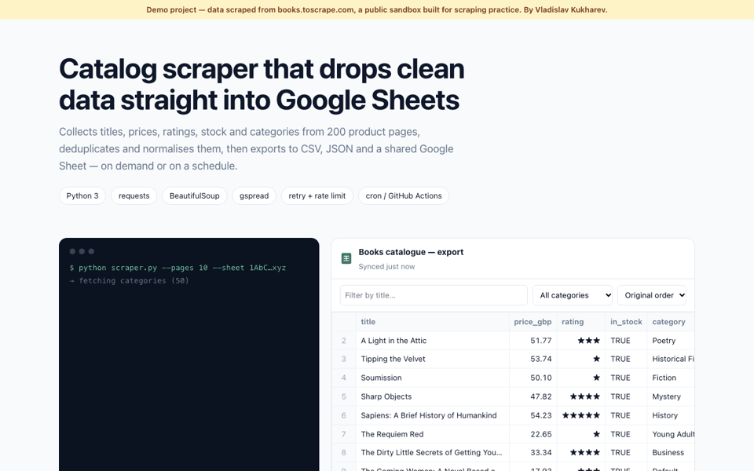

# Catalog scraper → CSV / JSON / Google Sheets

> **Demo project.** Built by Vladislav Kukharev as a portfolio piece.

Python scraper for books.toscrape.com, a public sandbox built for scraping practice, with a results viewer page.

**Live demo:** https://vk-scraper-sheets-demo.netlify.app · **Code:** https://github.com/Levelupacademybot/catalog-scraper-sheets

## Features
- Category mapping, pagination, typed and normalised fields
- Polite: 1 request/second, retries with exponential backoff, custom User-Agent
- Export to CSV, JSON and Google Sheets (gspread, service account)
- Viewer page with filters, sorting and stats

## Stack
Python, requests, BeautifulSoup, gspread · HTML/JS viewer

## Run
`pip install requests beautifulsoup4 gspread && python scraper.py --pages 10 [--sheet SHEET_ID]`

## License
MIT
